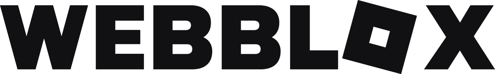
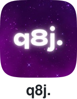

<h1>
  <picture>
    <source media="(prefers-color-scheme: dark)" srcset="art/readme-logo-dark.png">
    
  </picture>
</h1>

WebBlox is a modified version of Roblox's official WebAssembly client that lets you play any Roblox game
that the Windows client can play. It also includes a launcher.

## Contributors

<a href="https://github.com/q8j-dev"><picture><source media="(prefers-color-scheme: dark)" srcset="art/contributors/q8j-dev-dark.svg"></picture></a>&nbsp;&nbsp;&nbsp;<a href="https://github.com/gboiuokbc"><picture><source media="(prefers-color-scheme: dark)" srcset="art/contributors/gboiuokbc-dark.svg"></picture></a>&nbsp;&nbsp;&nbsp;<a href="https://github.com/NotRexed"><picture><source media="(prefers-color-scheme: dark)" srcset="art/contributors/NotRexed-dark.svg"></picture></a>&nbsp;&nbsp;&nbsp;<a href="https://github.com/woahhcrackers"><picture><source media="(prefers-color-scheme: dark)" srcset="art/contributors/woahhcrackers-dark.svg"></picture></a>

## Quick start

You need Node 22.15 or newer and a Chromium browser with WebAssembly JSPI and `exnref`. Current
Chromium based browsers work, on macOS, Windows or Linux.

```bash
npm start
```

| Address | Opens |
|---|---|
| `http://localhost:3000/` | The WebBlox launcher |
| `http://localhost:3000/?placeId=<id>` | That place, directly |
| `http://localhost:3000/roblox` | Roblox's own launcher |

When there is no signed in session, you are sent to Roblox's sign-in page, and Quick Sign In works. The
session lives in that browser's cookies, like on roblox.com: each browser signs in on its own, and a
private window starts signed out. The server keeps no copy.
Approve a Quick Sign In code from a device on the same network as the computer running the server:
Roblox refuses the approval from another network or city (mobile data and VPNs count), and the page
says so under the code. In Wisp mode Roblox sees the relay's location, so it usually refuses Quick Sign In.

To use without the Node server, see [Wisp mode](docs/usage.md#wisp-mode).

<sub>Thanks to [crackers](https://github.com/woahhcrackers) for Wisp mode!</sub>

## Docs

- [Usage](docs/usage.md) covers the launcher, graphics settings, URL and server options, the asset
  cache and Wisp mode.
- [Internals](docs/internals.md) covers how requests and joins work, the engine fixes, the desktop
  shaders and the project layout.
- [Maintaining](docs/maintaining.md) covers the engine auto-port tool and updating the launcher files.
- [TODO.md](TODO.md) lists open issues.

## Troubleshooting

| Symptom | Fix |
|---|---|
| Blank page, console mentions `WebAssembly.Suspending` | No JSPI, use an updated Chromium browser. |
| Stuck loading while window is hidden | Keep the window visible. |
| Join failing with 401 or 403 | Cookie/session expired. Sign in again. |
| Joins hang | Run `npm run flags` to see what Roblox changed since the flag pin, and `npm run flags -- bisect start` to find the flag. See [Pinning the flags](docs/maintaining.md#pinning-the-flags). |

leak = ban
